<div align="center">


**Run one coding agent — or a whole team of them — from a single terminal.**

Runs on its own small harness, **Bija**, on any OpenAI- or Anthropic-compatible API — paste a key and go — with **Codex** and **Claude Code** as backends you can add, mixed freely.
Two Rust binaries, nothing written into your project — and, one flag away, an installable web UI and end-to-end encrypted remote access, no server of your own required.

[Install](#install) · [Try it in one minute](#try-it-in-one-minute) · [Solo](#solo-one-agent-done-properly) · [Mandala](#mandala-a-team-that-plans-builds-and-checks) · [Anywhere](#anywhere-the-web-ui-and-remote-access) · [Under the hood](#under-the-hood)

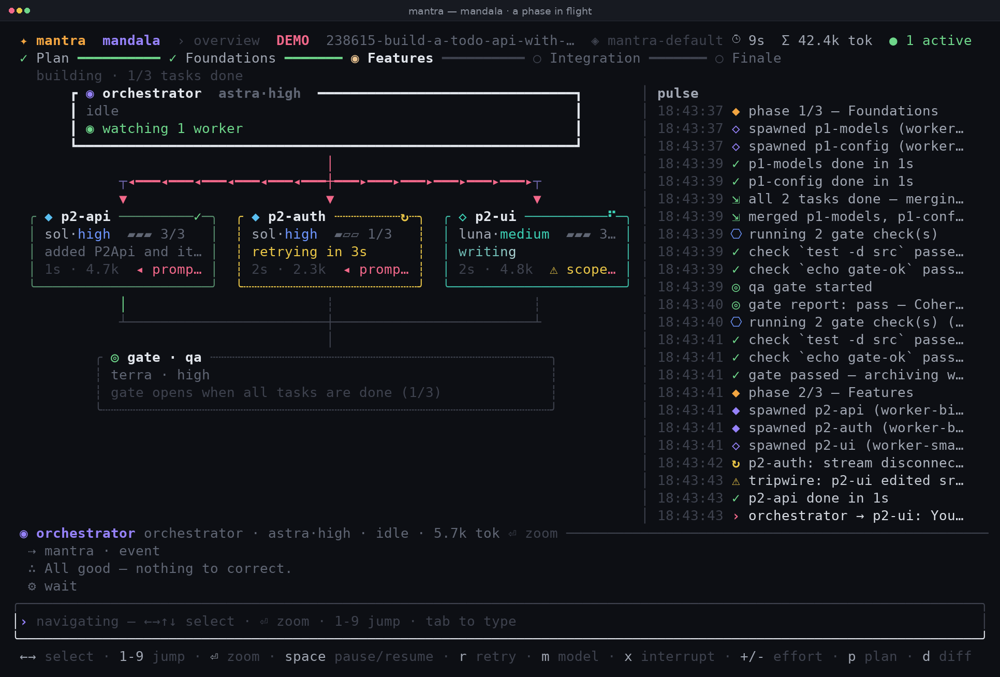

</div>

---

## What it is

You already have a coding agent in your terminal. Mantra is the room you put it in — and the room fits more than one.

|  | what you get |
|---|---|
| **Solo** | One agent, with everything you actually want on screen: the diff it is writing, its plan, how full its context is, what it is running right now. Type while it works. |
| **Mandala** | A whole team for one goal: a planner writes a phased plan, an orchestrator runs each phase, workers build **in parallel** in their own git worktrees, a fresh read-only QA agent checks the merged work every round and fix workers repair what it finds, a manager watches the whole run and unsticks whatever stalls, and a finale does one QA pass over the diff and a final verification. |

Each agent is its own process: `bija`, the small harness installed beside `mantra`, `codex app-server`, or `claude -p`. A fresh install asks you to configure a provider and model in `/models`; it does not assume an API key, a Bija endpoint or a Codex model list. Solo can also start individual subagents on any configured model alias, even when the aliases use different backends.

**Why you might want it**

- **Parallelism that is actually safe.** Every worker gets its own git worktree and a declared file scope. Mantra rejects a plan whose parallel tasks overlap, and trips a wire if a worker edits outside its scope.
- **Nothing silently stalls.** A watchdog knows who should be busy and nudges, respawns or escalates when they are not. Failures stop the run with a reason and the key that fixes it, instead of looping.
- **It survives being closed.** Runs are saved as they go; `mantra runs resume <id>` picks one back up where it stopped.
- **One place for models.** Aliases map to a model *and* the backend it runs through, so `sonnet5` via your Claude subscription and the same model via a gateway are two different, clearly labelled things. A provider is a pasted API key: Mantra finds the API and lists its models.

---

## Install

One line, Linux or macOS, no `sudo`:

```bash
curl -fsSL https://raw.githubusercontent.com/sahelea1/mantra/master/install.sh | sh
```

<details>
<summary>No curl, pinning a version, or building from source</summary>

```bash
# wget instead of curl
wget -qO- https://raw.githubusercontent.com/sahelea1/mantra/master/install.sh | sh

# pin a release, or force a source build
MANTRA_VERSION=v0.9.0 sh -c "$(curl -fsSL https://raw.githubusercontent.com/sahelea1/mantra/master/install.sh)"
MANTRA_FROM_SOURCE=1  sh -c "$(curl -fsSL https://raw.githubusercontent.com/sahelea1/mantra/master/install.sh)"

# from a clone (Rust ≥ 1.80) — one build makes both binaries
cd mantra_src && cargo build --release && cp target/release/mantra target/release/bija ~/.local/bin/
```

The installer puts two binaries side by side — `mantra` and `bija`, its agent harness — verifies a sha256 for each, installs to `~/.local/bin` (override with `MANTRA_INSTALL_DIR`), adds that directory to your `PATH` if it is missing, and finishes by running `mantra doctor`. Re-running it upgrades in place. If no release binary matches your platform (or its download or checksum fails) it builds from source, installing a minimal `rustup` toolchain first when `cargo` is absent; a release without a `bija` asset still installs `mantra` and reports the missing harness when a configured model needs it; a source build always brings both.

</details>

**Agents need a configured model.** In `/models`, choose an API provider, enter its key (or a local endpoint with no key), then choose one or more models. Bija itself ships with Mantra; it becomes usable when you explicitly add a Bija provider and a model on it. Codex and Claude Code are optional backends:

The built-in run patterns use their familiar role aliases on existing installations. When an
unchanged built-in pattern names an alias that a new installation has not configured, that role
uses the selected usable model for this run. The saved run pattern records the resulting choice;
patterns you edit yourself keep their exact assignments.

| backend | install | notes |
|---|---|---|
| Bija | ships with Mantra | add an API provider and model explicitly; any compatible API, [below](#models-providers-and-backends) |
| [Codex](https://github.com/openai/codex) | `npm i -g @openai/codex` then `codex login` | add model IDs from your account in `/models`; remove the account row to disable it |
| [Claude Code](https://docs.anthropic.com/en/docs/claude-code) | `npm i -g @anthropic-ai/claude-code` then `claude` once | choose subscription login or API key in the add menu |

Plus `git`, for the isolated worktrees. `mantra doctor` checks all of it and tells you exactly what is missing or broken — and when a CLI is there but unusable it names the file and the fix (*is a directory — something else on your PATH shadows the real binary*, *is not executable — chmod +x …*), rather than an errno.

`mantra doctor` probes readiness, not presence — one row and verdict each, the readiness probes capped at 10 s (the `--version` checks at 5 s):

- **bija** — checked when configured models use it: `bija_command` as configured, the binary beside `mantra`, or `$MANTRA_BIJA`
- **provider** — the default model's provider: where its key comes from (`$VAR` set, or stored in `models.toml`) and whether the endpoint accepts it, via `GET /models`; no inference is ever sent, and a placeholder URL such as `example.com` gets no request at all
- **codex**, **claude** — optional backends, *found* or *not found*; a missing one is a failure only when a model in `/models` runs on it. With Codex in use, its readiness follows: **codex app-server** — launched exactly as an agent launches it (provider args, the default model's key in the environment) and taken through the `initialize` handshake, then shut down cleanly — **sandbox** — one `true` run through the configured sandbox policy on that app-server, the same exec path agent commands take (`codex sandbox -- true` on servers without `command/exec`) — and `codex login status` (only a failure when something actually runs on Codex's own account)
- **sandbox**, when no model is on Codex — whether unprivileged user namespaces are there for bija's bubblewrap (without them its commands run unsandboxed, said once)
- then `git`, the terminal, tmux, and each provider's key source (a Bija provider's URL and wire too)

A failing row quotes Codex's own stderr line, exit code included. An agent that fails the same way at launch (not logged in, a refused flag, a bad gateway) is halted after 3 attempts with that error, instead of burning through the crash budget.

When the sandbox can't start at all (no unprivileged user namespaces), Mantra doesn't refuse to run: it warns once, up front, and runs agents' commands without the sandbox until the machine is fixed (Codex agents with `danger-full-access`) — no sandbox isolation, but git worktrees still keep workers apart.

---

## Try it in one minute

```bash
mantra --demo
```

Demo mode runs the real `bija` against a scripted mock API (and replaces the Codex and Claude Code CLIs with simulated ones, for the mixed-backend runs): real UI, real state machine, scripted agents, **no API calls, no provider key and no cost** (token totals read *simulated*). Press `ctrl+o`, type a goal, and watch a full team run play out in about twenty seconds. Every screenshot in this README is demo mode, captured by `docs/tools/shoot.py`.

```bash
cd your-project && mantra                       # Solo, in this repo
mantra run "add OAuth login to the API"         # straight into a team run
mantra run "port the tests to pytest" --parallel 16   # up to 16 workers at once, this run only
mantra runs                                     # every run: resume or delete
mantra doctor                                   # what's installed, what's missing
```

---

## Solo: one agent, done properly

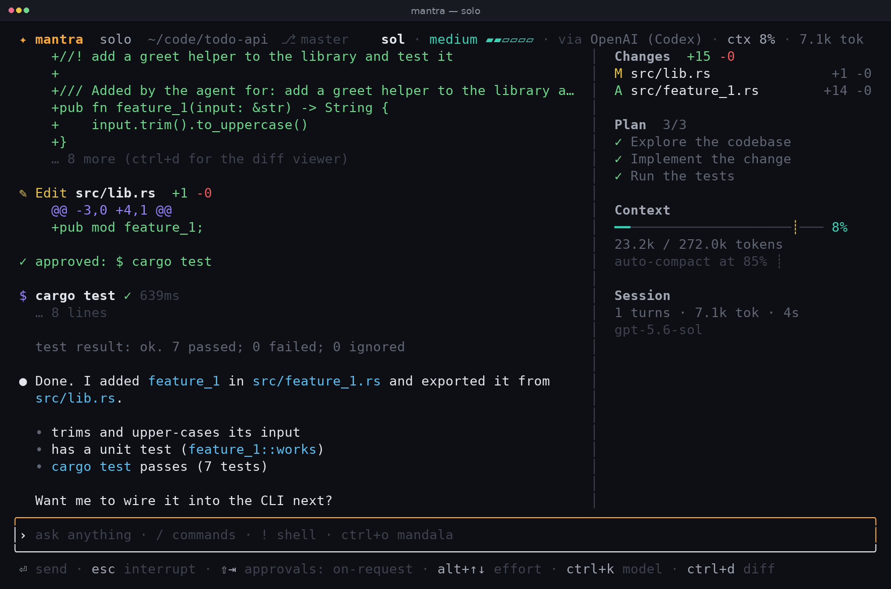

- **The diff as it happens** — every file touched with `+/-` counts, inline hunks, `ctrl+d` for a full viewer.
- **Its plan, live** — the agent's own checklist, ticked as it goes.
- **Context you can see** — a gauge with the auto-compaction threshold marked, so "it forgot everything" stops being a surprise.
- **Type while it works** — `⏎` queues your message behind the running turn (shown as a `⏳ queued` chip); `ctrl+f` shoves it into the turn right now.
- **Stop and delegate** — `ctrl+c` interrupts the active Solo turn while retaining your draft; Solo can start, message, inspect, wait for, and stop separate subagents using any configured model alias across Bija, Codex, and Claude Code.
- **Model and provider always in the header** — `sol · medium · via OpenAI API · ctx 8%`.
- **One settings screen** — `/settings` holds what used to be five commands; the *Settings* box below lists it.

<details>
<summary>Settings: everything you can change, on one screen</summary>

`/settings` is a form with an *about this setting* panel beside it. Type over a text field and `⏎` saves it; `←→` or `space` cycles a choice or flips an on/off; `esc` goes back to where you came from.

| section | what is in it |
|---|---|
| **Solo** | the default model (an alias from `/models`), approvals, sandbox, and which MCP servers Solo gets: all, none, or the ones you pick |
| **Runs** | the pattern new runs use; notifications (a desktop notification, or the bell, when a run needs you or finishes) |
| **Features** | Akasha, the experimental shared notes for agent groups |
| **MCP servers** | one row per server — name, command, on or off. `ctrl+n` adds one (a name, then its command line), `ctrl+t` tests it, `space` on its row enables or disables it, `Delete` (twice) removes it |
| **Web & remote** | the listen address, the password (write-only: it reads *set*), HTTPS and push; the URLs and certificate the web UI is served on; and the remote link, QR code, short code and password, with the identity rotatable |
| **Appearance** | glyphs, colours, reduce motion, mouse, frames a second, the side panel |

Most changes apply at once; a few say when they will (the toast tells you): the default model, sandbox and MCP choice reach Solo's next session (`/new`), Akasha reaches new runs, and the appearance and web settings apply at the next start. The web UI renders the same fields from the same code, so it accepts exactly what the terminal does. `mantra experimental` and `mantra mcp` stay for scripting.

</details>

<details>
<summary>Approvals — who gets asked, and when</summary>

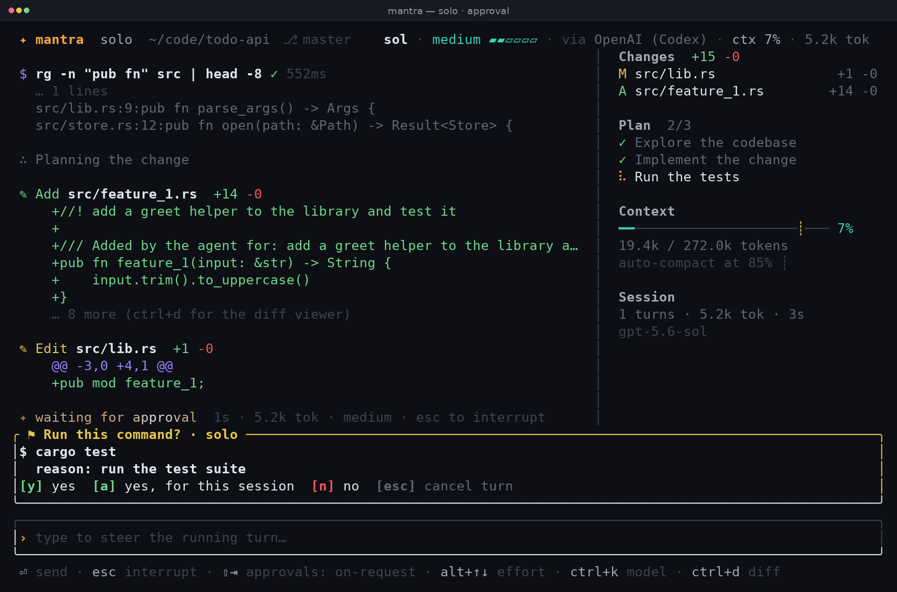

`shift+tab` (or *Approvals* in `/settings`) cycles **untrusted → on-request → never ask** for the Solo agent. These three ordinary modes apply to the live session immediately, even while a card is on screen. Codex applies them to its native tools. Bija and Claude Code run native tools unattended; for those backends these modes govern Mantra requests and questions. Their sandbox setting still applies.

- **untrusted** asks before anything that is not known-safe.
- **on-request** asks when the agent wants to leave its sandbox.
- **never ask** never prompts; anything that would have asked is auto-approved and written to the log (`✓ auto-approved (never ask): $ cargo test`). The sandbox still applies.

**BYPASS-SANDBOX-DANGER** is a separate choice in *Approvals*, not part of the quick cycle: no approval prompts and no backend sandbox. Entering or leaving this mode takes effect with `/new`; the current session keeps its existing permission, as shown in its footer. Codex receives `danger-full-access` and `never`; Bija uses `full`; Claude Code explicitly disables its sandbox. This does not change what the ordinary **never ask** choice means.

Automatic approval follows the requesting agent’s policy; it never grants another agent’s pending request.

Team roles have their own `permission` field in the Studio, `never` by default, so a run does not stop to ask. A role set to ask sends its questions to the inbox (`ctrl+g`). Claude Code agents always run with `--dangerously-skip-permissions` — a pipe cannot answer Claude's own prompts — so their containment is the worktree and the role's sandbox instead.

</details>

---

## Mandala: a team that plans, builds and checks

Press `ctrl+o`, describe the goal, and this happens:

**1. The planner writes a phased plan** and you approve it. Phases run in order; tasks inside a phase run in parallel with declared file scopes. Mantra validates the plan before you ever see it — unique ids, known roles, real prompts, and **no overlapping scopes between parallel tasks** — and sends errors back to the planner to fix. An empty project (nothing checked in yet) skips the exploration step — there is nothing to read.

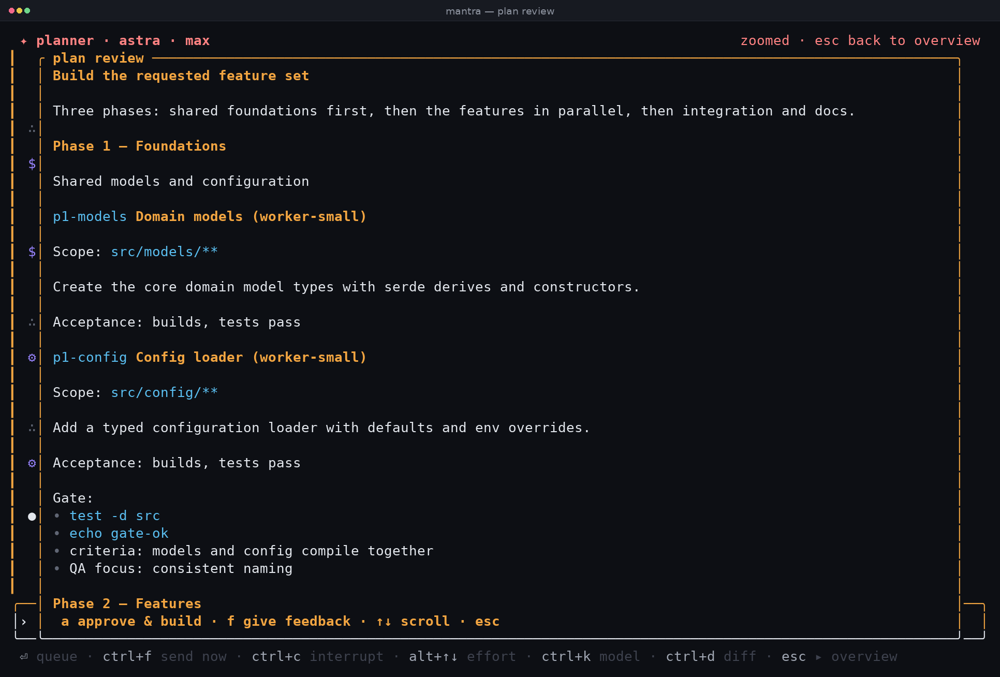

**2. The orchestrator runs the phase.** It spawns each task's worker into its own git worktree, then sleeps until something happens — a worker finished, failed, stalled, edited outside its scope, or **asked a question** — and decides what to do about it. Every few minutes it is also shown what each worker has actually been doing and asked whether the parallel work still fits together. Above it, from the first phase to the end of the finale, a **manager** watches the whole run: anything that stalls or halts reaches it first, and every few minutes it gets a health digest of the whole team.

**3. The gate merges, checks and reviews — and never fixes.** Mantra merges the worker branches, runs the phase's shell checks, and starts a **fresh, read-only QA agent** for the round: a new session that is handed the check results, the merged phase's `git diff --stat` and diff (capped; lockfiles left out) and the previous round's verdict — it starts from the diff instead of re-reading the repo. It verifies and reports with `mantra_gate_report`; on a fail the report is a work order (file, what is wrong, what to change), and `big` marks fixes that span several files. **Mantra routes the fix itself**: it spawns a worker named `fix-<round>` (`worker-small`, or `worker-big` when the report said so; merge conflicts always go to `worker-big`) with the findings as its prompt, scoped to the files the findings name, on the integrated copy. When it is done the checks run again and the next QA round starts — a fresh agent again. The same happens when QA passes but the checks still fail. `gate_max_rounds` bounds the loop; a check that keeps failing identically, a QA agent that reports the same blocker twice, or a fix worker that cannot do its job goes to the manager first (a hint, a fresh start) and then to the planner to fix — the plan, the checks — before it ever stops for you. Whatever the checks leave behind (`__pycache__`, build scratch, a formatter's edits) is dropped before the phase commit — the journal notes it — so it is never committed or landed.

**4. The finale** depends on the pattern (below). In the default one: a single QA pass that starts from the run's diff and the gate reports — security is a checklist inside it, defects go to fix workers — then the planner verifying its own plan against the same diff and reports, able to spawn fix workers for real gaps.

**5. `/land`** merges the run branch into yours. Everything else lives in `~/.mantra` — plan, journal, per-phase outputs, merge logs. Nothing is written into your project.

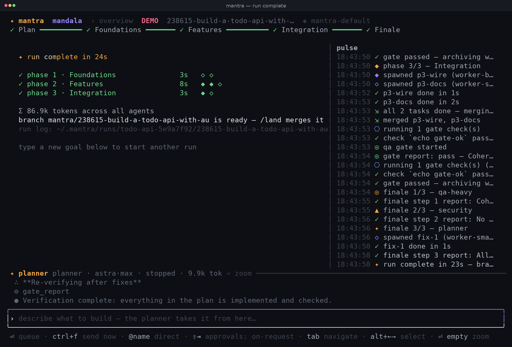

<details>
<summary>Zoom into any agent — it is just Solo again</summary>

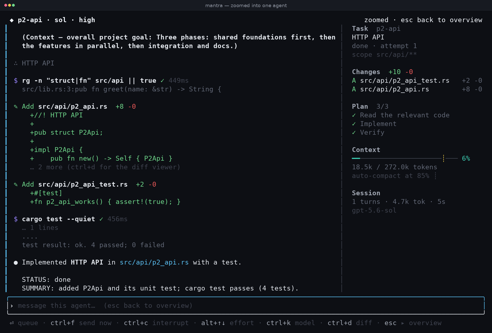

`⏎` zooms into the selected agent, `1`–`9` jump straight to the *n*th, `esc` goes back. A zoomed agent gets a solid role-coloured header band and a coloured spine down its log, so you always know whether you are looking at one agent or the whole team. A run **starts** zoomed into the planner; approving the plan lands you back on the overview.

You can talk to anyone: plain text on the stage re-prompts the planner, `@p2-api use axum` messages one worker directly.

Token counts are the backend's running totals — every request's *whole* input plus its output — so a worker that cycles tools in a big context reads millions. Where most of that was the same context served from the cache, the card, the zoom header, the peek strip and the run's `Σ` add `· 5.9M cached` in a muted suffix (the web app's chips and run page do the same), so a big number is read as what it is. A finished card names the model its attempt actually ran on, even after the role's model was changed for the next spawn. The backend's own housekeeping warnings (it could not save its diagnostic logs, say) are a muted line in the agent's log, said once, never the card's line.

</details>

<details>
<summary>The manager: someone whose job is the whole run</summary>

Every other agent owns a slice — a plan, a phase, a task, a gate. The **manager** owns the run. It starts with the first phase (right after you approve the plan), is briefed once with the goal, the phases and the run's settings, and stays through every phase and the finale. It never edits code: its sandbox is read-only and its tools only steer other agents. In the default pattern it is `◈`, on `sol` at `auto` effort.

Two things wake it:

- **Escalations.** A gate or a task out of attempts, an agent whose turn failed past its free respawn, or an agent the watchdog could not get moving, reaches the manager before the planner (or you), with the same facts. It reads first — `mantra_status` is the whole run for it, `mantra_log` on the agent involved, `mantra_journal` for the recent journal — then makes the smallest intervention: a hint (`mantra_prompt`, or `mantra_resume_run` when halted), a fresh start (`mantra_retry` a task, `mantra_respawn` any agent with a note), a different effort, a word to the orchestrator. Restarting an agent during an escalated halt *is* the decision to go on: it lifts the halt, and an exhausted task gets one more attempt. Changes to the plan or the gate checks are the planner's — it hands those up with `mantra_ask`.
- **A health digest**, every `manager_minutes` (default 5; 10 in `mantra-default`) while the team builds or the finale runs: stage, plan progress, every non-worker agent with what it is doing and how long it has been quiet, all workers, the last journal lines — and the instruction to intervene only where something is off, otherwise `mantra_wait`.

It asks you (`mantra_ask_user`) only when nobody in the team can decide — credentials, the machine, a trade-off that is yours. The band reads *the manager asks: …* and your next message answers it.

On the stage it is the mini-card at the top right, mirroring the planner on the left (from 90 columns; during the finale it sits above the ad-hoc fixes). Select it with the arrows or `1`–`9`, zoom into it, message it with `@manager …`, respawn it with `r`. `mantra runs resume` re-attaches it to its own thread, so what it learned about the run is kept. It is a supervisor, not a step of the run: if its own turn fails past the retries it is dropped — never a halt — whatever it held goes on to the next rung (the planner, or you for a failed turn), and a fresh manager comes with the next escalation or health digest.

**Turning it off.** Set `flow.manager = ""` — in the Studio (flow → manager → *none*) or in your pattern file — and the planner is the top of the chain again, exactly as before; pattern files written before v0.4.0 load unchanged, without a manager. `manager_minutes = 0` keeps the manager for escalations only, with no periodic digest.

</details>

<details>
<summary>When something goes wrong: halts</summary>

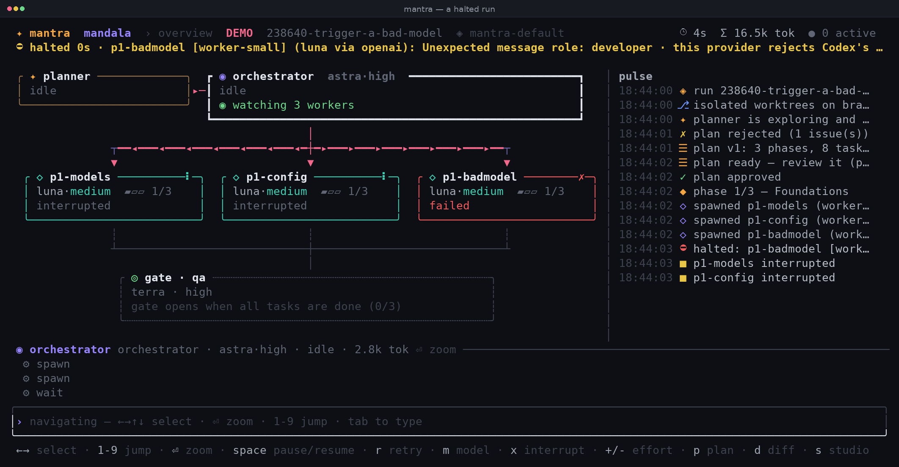

There is no vague "paused" state. A run that cannot continue **halts** with a typed reason, an amber band naming the agent and the error, and the key that fixes it:

| halt | what happened | what the band tells you |
|---|---|---|
| paused by you | you pressed `space` — nothing new starts until you resume | `space` to resume |
| auth / usage limit | 401, 403 or quota | fix credentials, then `space` |
| provider rejected | HTTP 400/422 — e.g. a gateway that refuses Codex's `developer` messages | `m` switches that role's model and resumes |
| environment | a command died in the sandbox (`bwrap`, user namespaces) — reported once, then Mantra halts right away instead of retrying blind | fix the machine — `mantra doctor` prints the sysctl |
| gate exhausted | QA ran out of rounds, repeated the same blocker, or the same check failed identically twice (a fix worker that is blocked or whose turn fails is an *attempts exhausted* halt on `fix-<round>`) | the manager has already been handed it, and the planner after it (see *the chain of command* below); `space` retries, or type feedback |
| attempts exhausted | a task used every attempt | the manager, then the planner, has been handed it; `r` on the task resumes and retries |
| agent turn failed | a role's turn failed past its retries and one free respawn | the manager has been handed it first (it respawns the agent with a note); if it does nothing the band is yours — `r` respawns the agent |
| model gateway down | a worker (a fix worker too) failed on a 5xx / reset connection past its free retries, or an escalation's own error is a transport one | nobody is woken — the manager and the planner run through the same gateway; `space` when it is back, and every worker the outage took is respawned where it was, for free |

**Pause is a hard boundary.** While a run is paused nothing new starts — no next phase, gate round, handoff or finale step. Results that arrive mid-pause (a QA report, gate checks, a cleanup commit) are recorded; the transition they trigger is kept in `state.json` and performed exactly once on resume, even after a restart. The header's `⏱` counts active time only — it stops on every halt, pause included — and freezes at the final duration when the run completes or stops.

</details>

<details>
<summary>The watchdog: nothing sits idle</summary>

A long run should never quietly stop. Mantra knows who *should* be working at any moment — planning, orchestrating, building a task, gating, running a finale step — and escalates when they are not:

1. idle for `watchdog_seconds` (90 s): nudge the agent;
2. idle for `watchdog_escalate_seconds` (240 s): respawn the orchestrator, or wake it about the idle agent;
3. twice that: wake the manager, when the pattern has one — and if it has not reacted by `watchdog_escalate_seconds`, wake the planner to sort it out (without a manager the planner is woken straight away, as before);
4. still nothing: halt, rather than pretend.

Every rung is journaled with `⏰`, and the idle agent's card turns amber. A manager that sits on a case it was handed climbs the same ladder: nudge, respawn, then the planner takes over what it held. Any agent can also be respawned by hand with `r` (or `ctrl+r`, or `/respawn`) — planner, orchestrator, gate, finale step or worker, each restarted with a prompt carrying the current state.

There are guards for the silly failures too: a worker whose task is already done cannot be prompted, an orchestrator that prompts the same stuck worker three times in five minutes gets that worker respawned instead, and nothing can be spawned while the run is halted.

**A stop you make by hand outranks all of it.** `ctrl+c` (or `x`) on an agent marks it *stopped by you*: no nudge, no gate round, no retry, no "continue where you left off" after a process restart, and the watchdog steps over it. It stays stopped until you message it (which is how you restart it) or press `r` to respawn it — the card and `mantra_status` say so, so the orchestrator doesn't mistake it for a worker that merely went quiet.

</details>

<details>
<summary>Telling "still thinking" from "hung"</summary>

A long reasoning turn used to look exactly like a crashed one. Now it doesn't:

- a Claude agent's thinking label carries its own running count — `thinking · 9.4k`, climbing every second or two;
- if the stream really does go silent, the status line and the agent's card append an amber `· quiet 1m20s`, counting from the last byte the process sent;
- a planner, orchestrator or gate agent that is connected but silent past `stall_minutes` gets one journal line (`⏳ … no output for 6m00s — still connected`). Workers already have the stall tripwire, which also wakes the orchestrator.

Nothing here acts on your behalf — it just stops you having to guess.

</details>

<details>
<summary>The chain of command: ask, don't guess</summary>

Decisions travel **up**, never sideways, and only reach you when they have to:

| who | asks | how | answers with |
|---|---|---|---|
| worker, gate, finale agent | the orchestrator | `mantra_ask` | the orchestrator's `mantra_prompt` |
| orchestrator | the planner | `mantra_ask` | the planner's `mantra_brief_orchestrator` |
| manager | the planner — for a change to the plan or the gate checks | `mantra_ask` | the planner's `mantra_prompt("manager", …)`, or a `mantra_revise_plan` that resumes the run |
| planner, manager | **you** | `mantra_ask_user` | your next message on the stage |

An agent that stops to wait is shown as *asked a question · waiting for the answer* — never mistaken for "done" — and the rung above it becomes the one the watchdog expects to act. The planner is told to decide by itself whenever the answer keeps the end product and the plan's intent, and to ask you only when it changes what is being built, its scope, or is a trade-off only you can make. The manager asks you only when nobody in the team can decide. A question to you is a saffron band, not a halt: the run keeps going meanwhile.

The same chain carries halts: **manager → planner → you**. *Gate exhausted* and *attempts exhausted* go to the manager first, with the failing checks and their output. It has `watchdog_escalate_seconds` to act — a hint and `mantra_resume_run`, a fresh start with `mantra_retry` / `mantra_respawn` (during an escalated halt that lifts it), `mantra_ask` to the planner when the tasks or the checks themselves are wrong — and one reminder if it ends a turn without acting; then the planner gets the escalation exactly as before, with exactly three moves: `mantra_revise_plan` (the run resumes by itself — a task changed after it was done is re-opened, a phase already gating goes back to building, a changed gate just re-runs its checks), `mantra_resume_run` with a hint for the stuck agent, or `mantra_ask_user`. If it does nothing, one reminder; then the band is yours. A pattern without a manager skips the first rung.

`settings.review_minutes` (default 3, `0` off) sets how often the orchestrator gets a digest of every running worker — activity, files touched, recent log — to check that the parallel work stays coherent with each other and with the phase goal.

</details>

<details>
<summary>Experimental: Akasha, shared notes for agent groups</summary>

*Ākāśa* is the space that holds everything. Agents in a **group** share one small block of notes: a fact about the codebase, a decision, an interface one of them created, a pitfall — what an agent working beside them would want to know. Each agent keeps its own context and its own reasoning; the block is the part it chooses to share, plus what Mantra shares for it (a task done or failed, the files it changed). It is experimental: the file format and the tools may change.

**Turning it on.** It is off until you switch it on, and while it is off a pattern with groups runs exactly as if it had none (the journal says so once, at run start):

```bash
mantra experimental                  # every experimental feature, on or off
mantra experimental enable akasha    # saved in settings.toml; disable turns it off again
```

In the app, *Features* in `/settings` lists the same and switches it (a run already open keeps what it started with). `mantra --demo` has it on, and a demo run whose goal says "swarm" — `mantra --demo run "build a tiny todo CLI, its tests written by a swarm"` — shows notes being shared.

**The pattern** names its groups; every built-in ships with one, `builders`, of all three worker roles (it does nothing while Akasha is off):

```toml
[[groups]]
name = "builders"
roles = ["worker-big", "worker-small", "worker-swarm"]   # roles of this pattern, each in one group at most
shared_chars = 16384                     # the block's size, in characters (1024–262144)
push = "urgent"                          # which new notes reach busy members mid-turn: none | urgent | all
auto = true                              # Mantra adds a line when a member's task ends, and the files it changed
```

The Studio shows a pattern's groups in its overview, read-only; they are edited in the file, or by the architect.

**What the agents get.** Members have four tools: `mantra_akasha_read`, `mantra_akasha_note` (`text`, `urgent`), `mantra_akasha_amend` (`id`, `text`) and `mantra_akasha_forget` (`id`). Every prompt Mantra sends a member — the spawn brief, a retry, a nudge, a resume — ends with the block as it stands. A note marked urgent goes to every other member that is busy right then, as a steer between its tool calls (at most one every 20 s per agent, the waiting ones joined); a member that is idle is never woken for it and reads it with its next prompt. The block has a hard size: a note that would overflow it is refused with how much is over, and the agent is told to forget what went stale. Mantra's own lines give way first — when the block is full they are dropped, and the journal says so.

**Where you see it.** `/akasha` (it asks which group when there are several; `/akasha builders` goes straight there) opens the run's blocks as the agents read them, urgent notes marked `!`; the web app's run page has a folded *Shared notes* section; every note, amend and forget is a journal line. The blocks are saved with the run, so a resumed run picks them up where they were.

</details>

---

## Models, providers and backends

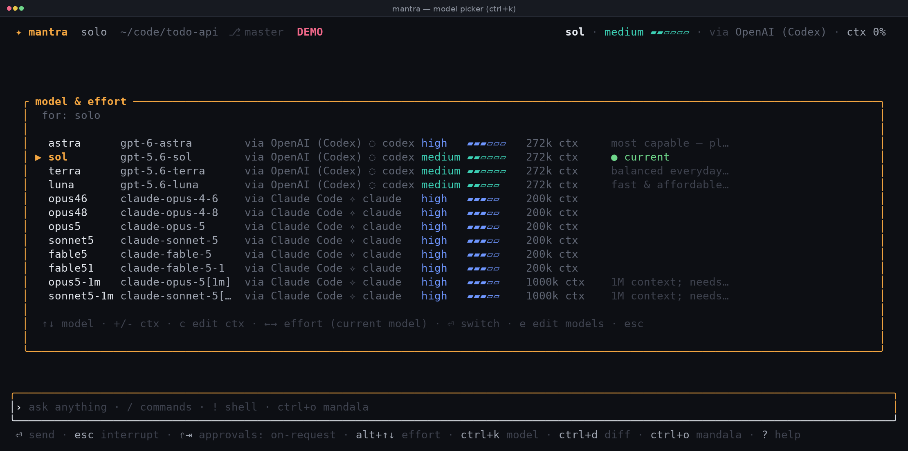

An alias maps to a model **and the runtime it goes through**, and every picker says which: `via OpenAI API • bija`, `via OpenAI (Codex) ◌ codex`, `via Claude Code ✧ claude`. The same model reached two ways is two clearly-labelled rows. `ctrl+k` switches the model for the focused agent — the switch is validated against that agent's actual backend first, so it is refused rather than sent to an agent that cannot run it; `+`/`-` adjust its context window right there. Whatever a model or effort switch — or a respawn — interrupts, nothing you typed is lost: a message queued at the time is held and replayed once the agent is ready again.

In Solo, the agent can list configured model aliases and start a separate subagent on any usable alias, including one on a different backend. It can message, inspect, await, and stop each subagent through its tools. Each child is a separate process in the same project; starting a new Solo session shuts down that session's children.

Use the **Codex** backend for a ChatGPT subscription and **Claude Code** for its CLI login. **Bija** uses configured API endpoints and keys; it does not reuse a ChatGPT subscription.

Drafts stay with each conversation while the terminal or browser page remains open. Navigation, overlay dismissal, and browser reconnects preserve them; a full browser reload starts fresh. Long remote transcripts use a bounded visible window, with earlier history and full message text available on demand.

**Akasha swarms.** Solo can start a small group of independent agents with a shared notebook. For a team role, enable **Can spawn swarm** in `/studio` (or the remote pattern editor); it is off by default for roles. Each group has up to eight members, with at most sixteen live swarm members across the app. Members use configured model aliases, can mix backends, and inherit the parent’s active permission and working directory. They cannot spawn more swarms. Split work by file or responsibility: members share the parent’s workspace rather than getting separate worktrees.

The parent uses `mantra_swarm_start`, `mantra_swarm_status`, `mantra_swarm_wait`, `mantra_swarm_message`, `mantra_swarm_note`, and `mantra_swarm_stop`. Members coordinate through the Akasha note tools. `/akasha` shows their notes in the terminal; remote agent pages show the group, member links and folded shared notes. Ending the parent or replacing a Solo session ends its members too. Delegated groups are session-local; normal run Akasha groups retain their existing persistence.

To add an API provider, press `ctrl+n` in `/models` and pick a known API (OpenAI, Anthropic, OpenRouter, Groq, xAI, Gemini, Cerebras or Fireworks), or *Local / custom API*. The choice fills in the endpoint; you can edit it before saving. Paste its key, or leave the key empty for a local server. Mantra then lists the provider's models for you to select. The key is stored in `models.toml` (`0600`). A refused key or a URL without a model list keeps the provider so you can add models by hand. Key prefixes can still suggest an endpoint in the custom flow.

<details>
<summary>Which key prefix goes where</summary>

| prefix | host | wire |
|---|---|---|
| `sk-ant-` | `api.anthropic.com` | Messages |
| `sk-or-` | `openrouter.ai` | Chat Completions |
| `gsk_` | `api.groq.com` | Chat Completions |
| `xai-` | `api.x.ai` | Chat Completions |
| `AIza` | `generativelanguage.googleapis.com` | Chat Completions |
| `csk-` | `api.cerebras.ai` | Chat Completions |
| `fw_` | `api.fireworks.ai` | Chat Completions |
| `sk-`, `sk-proj-` | `api.openai.com` | Chat Completions |
| anything else | no guess — you give the URL | Chat Completions |

A URL you type always wins over the guess (a `sk-` key for another OpenAI-compatible host keeps that host). A key for an endpoint already configured updates that provider instead of adding a second one. No Bija endpoint is preconfigured on a fresh install.

</details>

**Codex** uses the model IDs you add to `models.toml` in `/models`; Mantra no longer imports a fixed Codex catalogue. Choose *Codex account model*, type the ID, and edit its alias or capabilities in the grid; the Discover action can ask the running Codex app server for its current catalogue. The `openai · Codex (ChatGPT login)` row appears while at least one Codex model is configured. Delete it twice to remove all its models, including when it is the only backend. **Claude Code** offers separate subscription and API key choices; the latter opens the key field and can also read `$ANTHROPIC_API_KEY`.

Effort resolves per model → per role → per agent at runtime (`alt+↑/↓`), clamped to what the model actually supports. When a role asks for an effort its model does not offer (`max` on a model that stops at `high`), the agent's transcript says so once and the pattern overview shows requested→used.

A role can also say `effort = "auto"` (the Studio cycles it first): Mantra then picks per spawn from the role's job — planner, manager, orchestrator and gate `medium`; a worker `low` for `worker-small` and `worker-swarm` and `medium` otherwise; any role running a finale step `high` — and the agent list shows the level it actually runs at. A named effort is always used as it is.

<details>
<summary>Bija: the built-in harness</summary>

Bija (*bīja*, a seed — the smallest mantra there is) is Mantra's own agent harness: a small Rust binary, installed beside `mantra`, that turns any OpenAI-compatible Chat Completions API — or an Anthropic-compatible Messages API — into a coding agent: file tools, commands with a timeout or in the background, every retryable API error retried with backoff, every message on disk as it happens. No Node, no login: a key, or none for a local server.

Mantra starts without Bija provider or model presets. Add your endpoint and choose its models in `/models`; a local server can use no key. Existing `models.toml` entries are preserved, including older `-api` aliases. `mantra --demo` supplies temporary mock models in memory and does not edit your configuration. Built-in patterns refer to the example aliases `astra`, `sol`, `terra` and `luna`: set those aliases to your chosen models or edit the roles in the Studio before starting a run.

```toml
[[provider]]
id = "local"
kind = "bija"
base_url = "http://127.0.0.1:11434/v1"   # Ollama, vLLM, a gateway, the OpenAI API…
wire = "openai"                          # or "anthropic" for a Messages API
env_key = "LOCAL_API_KEY"                # optional: a local server takes none
```

Each agent is one `bija` process speaking NDJSON over stdio, its session in `~/.mantra/bija/sessions/<id>/`. Steering lands at the next tool boundary, `x` interrupts (and kills the running command's process group), a model or effort switch applies from the next request without a restart, and a crash resumes the session from its transcript — mid-turn, with the tool call it was in repaired. Mantra's own tools are offered beside the built-ins and answered by the Conductor, as for Codex. The sandbox decides where the file tools may write — nowhere (`read-only`), the agent's directory plus its extra writable roots and the temp dirs (`workspace-write`), or anywhere (`danger-full-access`) — and commands run inside bubblewrap where it works, able to write only there and in the temp dirs; where it doesn't they run unsandboxed, and the agent's log says so once. The key reaches `bija` only through its environment, and is removed from the environment of every command it runs.

`bija` also works on its own — `bija run`, `bija sessions`, `bija show <id> -f` to follow a transcript, `bija send <id> "…"` to prompt a session served with `--control` (Mantra's are not); `bija --help` has the rest, and [`mantra_src/bija/SPEC.md`](mantra_src/bija/SPEC.md) the protocol any orchestrator can drive it with.

</details>

<details>
<summary>Claude Code as a backend for any role</summary>

With `claude` on your `PATH`, *Claude Code* in the add menu (`ctrl+n` in `/models`) adds a `claude` provider with `opus46`, `opus48`, `opus5`, `sonnet5`, `fable5`, `fable51` at a **1M** context window and `haiku45` at 200k. Claude Code announces your account's real window a second after each agent starts, and on a subscription login that is what the gauge uses — so it is right from the first turn whatever your plan grants (an `api_key` gateway keeps the window you configured). An older `models.toml` keeps whatever `context_window` it has — set it to `1000000`, or delete the Claude models and add Claude Code again. Point any role at a Claude model in the Studio, like any other model — the planner and the manager on Claude with the workers on bija, say, is a few edits there, or one sentence to the architect.

Under the hood each agent is one long-lived `claude -p --input-format stream-json …` process. Mantra translates its event stream into the same shapes the UI already renders, so nothing else in the app knows the difference: steering lands at the next tool boundary, `x` sends a real interrupt, `/compact` compacts the session, and a crashed process restarts with `--resume`.

Mantra's own tools (`mantra_spawn`, `mantra_submit_plan`, …) reach Claude through MCP: Mantra opens a socket and passes `--mcp-config` pointing at `mantra mcp-bridge`, which `claude` starts itself. Nothing to configure. MCP servers you give the agent ride in the same config (see *MCP servers* below).

**Third-party gateways** work through the same backend — set `kind = "claude-code"`, `auth = "api_key"`, a base URL and a key:

```toml
[[provider]]
id = "libertai-claude"
name = "LibertAI (via Claude Code)"
kind = "claude-code"
auth = "api_key"
base_url = "https://api.libertai.io"   # bare host; Mantra strips a trailing /v1
env_key = "LIBERTAI_API_KEY"           # or api_key = "…" to store it (chmod 0600)
```

This is also the way around gateways that reject Codex's `developer` role: same model, same key, different runtime.

</details>

<details>
<summary>Providers by hand: models.toml, discovery, drafts</summary>

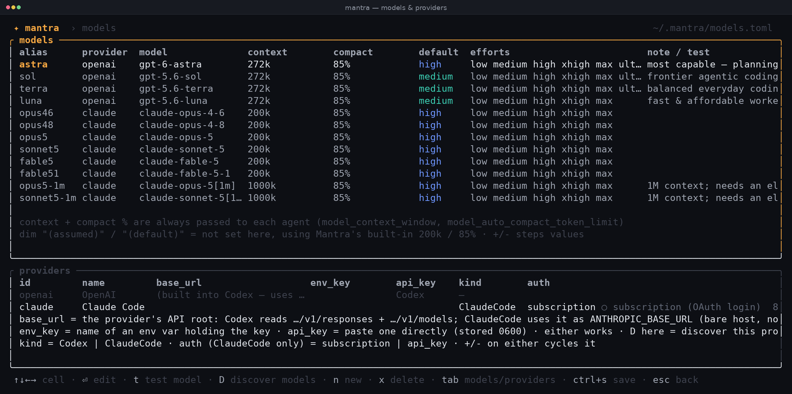

`/models` edits everything live: type over a field and `⏎` saves it, `+/-` step a value, `ctrl+t` tests a model for real, `ctrl+d` discovers a provider's models, `ctrl+n` adds, `Delete` (twice) removes, `tab` moves between the models and the providers grid — and `esc` puts you back on exactly the screen you opened it from, zoom included. The selected row is highlighted across the whole width, so its context, compaction, effort, vision and note cells read as one row. The key flow writes a provider for you; by hand — in the providers grid or in `models.toml` — it is four fields:

| field | meaning |
|---|---|
| `id` | short name shown next to its models |
| `base_url` | the API root — bija calls `…/chat/completions` (or the Messages endpoint with `wire = "anthropic"`), discovery reads `…/models` |
| `env_key` | **name** of the environment variable holding the key |
| `api_key` | *or* paste the key directly: stored `0600`, delivered only through the child process's environment, never on argv or in logs |

`kind = "bija"` runs a provider on the harness — any Chat Completions API, or a Messages API with `wire = "anthropic"` — which is what the key flow writes. A `[[provider]]` with no `kind` reads as Codex and must speak the OpenAI *Responses* API. The provider at `openrouter.ai` through bija — what pasting an `sk-or-` key writes — with one model on it:

```toml
[[provider]]
id = "openrouter"
name = "openrouter.ai"
kind = "bija"
base_url = "https://openrouter.ai/api/v1"
env_key = "OPENROUTER_API_KEY"           # or api_key = "…"

[[model]]
alias = "luna-or"
provider = "openrouter"
model = "openai/gpt-5.6-luna"
context_window = 400000
efforts = ["low", "medium", "high"]
```

On Codex, a custom-provider model with an `efforts` list gets a reasoning effort like any OpenAI model — Codex ≥ 0.150 sends it on its own, nothing extra is configured; one without gets no reasoning block at all, which keeps strict gateways happy.

Press `ctrl+d` on a provider (the key flow does it for you) and Mantra fetches its catalogue: context windows are read from whatever field the provider uses (and marked *assumed* at 200k when it reports none), reasoning effort is enabled only when the model actually supports it, and models you already have are never duplicated.

`ctrl+t` runs a real test turn including a `developer` message — so a gateway that rejects that role fails here, not three minutes into a run. Starting a run also pre-flights every role's provider and refuses with the exact missing variable name.

A provider whose URL and key are not real yet is a **draft**: `/models` shows *draft — why* (the `example.com` placeholder, a malformed URL, an env var that is not set and no stored key) and `ctrl+t`/`ctrl+d` stay off, so no credential is ever sent to a placeholder. A placeholder URL — `example.com` and the other RFC 2606 names — is refused by runs and by `mantra doctor` as well. Plain `http://` to a LAN box (`http://192.168.1.20:8000/v1`) is a real provider.

</details>

<details>
<summary>Context and compaction</summary>

Every agent is launched with an explicit context window and compaction threshold — its own numbers, or a conservative assumed 200k / 85% — passed as `model_context_window` + `model_auto_compact_token_limit` to Codex and `--autocompact` to Claude. A 16k model compacts instead of dying. A worker that still overflows on an assumed window gets it halved for the next attempt, with a log line telling you to set the real one.

`/compact` compacts by hand (deferred to the end of the turn if one is running), each compaction appears once in the log as `⇣ context compacted · 182k → 31k`, and the orchestrator is reset or compacted between phases. A turn that contains only a compaction never counts as "the agent finished".

</details>

<details>
<summary>MCP servers: give agents your tools (Blender, say)</summary>

Any stdio MCP server can be handed to agents on all three backends. Blender is the worked example: its MCP add-on runs inside Blender, and the server agents talk to is `uvx blender-mcp`. With Blender open and the add-on connected:

```sh
mantra mcp add blender -- uvx blender-mcp   # adds it to settings.toml, enabled
mantra mcp test blender                     # starts it, lists its tools, exits 0 or 1
```

`mantra mcp test` waits 20 s for the server to answer; `--timeout 120` gives a first `uvx` run, which downloads the server, the time it needs.

which is the same as writing this into `~/.mantra/settings.toml` yourself:

```toml
[mcp_servers.blender]       # any name: letters, digits, - and _
command = "uvx"
args = ["blender-mcp"]
env = { }                   # optional, added to the server's environment
enabled = true              # false keeps the entry and never starts it
```

`mantra mcp` lists the servers (command, on or off, whether Solo gets it); `add <name> [--env KEY=VALUE]… -- <command> [args…]`, `remove`, `enable`, `disable` and `test` do the rest. Run `test` once after adding a server: the first `uvx blender-mcp` downloads it, which can take longer than an agent waits for a server to start. A server with an `env` makes settings.toml readable by you only (0600); its values still reach the command line of the Codex and Claude Code agents given it. In the app the same list is *MCP servers* in `/settings`: `ctrl+n` adds one (a name, then its command line), `ctrl+t` tests it, `space` on its row enables or disables it, `Delete` (twice) removes it. Changes made while Mantra is open reach the next Solo (`/new`) and the next run.

**Who gets which.** Solo gets what `solo_mcp` names — every enabled server by default (`["*"]`), `[]` for none; *MCP servers* under Solo in `/settings` shows them and sets it — all, none, or the ones you pick — for the next agent (`/new`). A Mandala role gets nothing unless its pattern says so: `mcp = ["blender"]` on the role (or `["*"]`), edited in the Studio like the role's other lists. A role asking for a server that is not configured starts without it, and the run's journal says so once.

**Per backend.** Codex gets each server as `-c mcp_servers.<name>.…` and runs it itself; Claude Code finds it beside Mantra's own server in `--mcp-config` (under `--strict-mcp-config`, so nothing else of yours comes along — except for a Solo agent given none of these, which keeps the servers you set up with `claude mcp add`, as it always had them); bija gets an `mcp.json` in its session directory and starts every server with the session, again on a resume, and stops them with it — one that fails to start is a warning, and the agent goes on without it. Whichever backend, a call shows on the agent's card as `blender.get_scene_info`. Any stdio MCP server works the same — a filesystem server, a browser, a database. A server runs as you, outside the agent's sandbox (a read-only role given a filesystem server can write through it), so give a role the servers its job needs and no more.

`mantra --demo` brings a stand-in (`mantra mock-mcp`, as `demo`, with a three-object scene) and gives it to every agent, so you can watch the calls without installing anything.

</details>

<details>
<summary>Seeing the screen: screenshots and images for vision models</summary>

A model that takes images has `vision` on in `/models` (`◉`, `space` toggles it): a new `models.toml` has it on for the built-in aliases, and `ctrl+d` sets it on the models it adds when the provider's catalogue says so. A `models.toml` from before 0.7.0 gets it switched on once, at its first load, for the models of the built-in families (any other is yours to switch on in `/models`). Its agents — and only theirs — get two tools that Mantra runs:

| tool | does |
|---|---|
| `mantra_screenshot` | captures the screen of the machine Mantra runs on (`region = "x,y,w,h"` for a part of it, `display` to pick one), saves it to the run's `screenshots/<agent>-<n>.png` (Solo: `~/.mantra/screenshots/`) and hands the agent the image and the path |
| `mantra_view_image` | shows the agent a PNG, JPEG, GIF or WebP file (8 MB at most) from its working directory |

Nothing is captured unless the model calls the tool, and each capture costs context, so the tool tells it to look when it needs to and at a region when it knows where. Mantra captures with the first that works of `grim`, `gnome-screenshot`, `scrot`, ImageMagick's `import` and, on macOS, `screencapture`; with none of them, the tool says what to install. `MANTRA_SCREENSHOT_CMD` overrides the lot with a command of your own — `{out}` is the file to write, `{region}` the region — and is how the tests capture on a machine without a display. It runs with `sh -c`, as you, with Mantra's environment, and `{out}` and `{region}` go in already quoted: write `scrot {out}`, not `scrot "{out}"`. A capture never holds up the other agents (it runs beside them), and the files are readable by you only.

On bija the model also gets bija's own `screenshot` and `view_image` (`--vision`, which Mantra passes for these models, and takes back when you switch the agent to a model without vision); in Mantra they see the same machine. The image reaches the model the way its API takes one, and the transcript keeps a path, not the picture: bija saves it under the session's `images/`. A tool call that returned an image shows `▣ image` (`[img]` in ASCII) and the path on its card.

</details>

---

## Runs you can walk away from

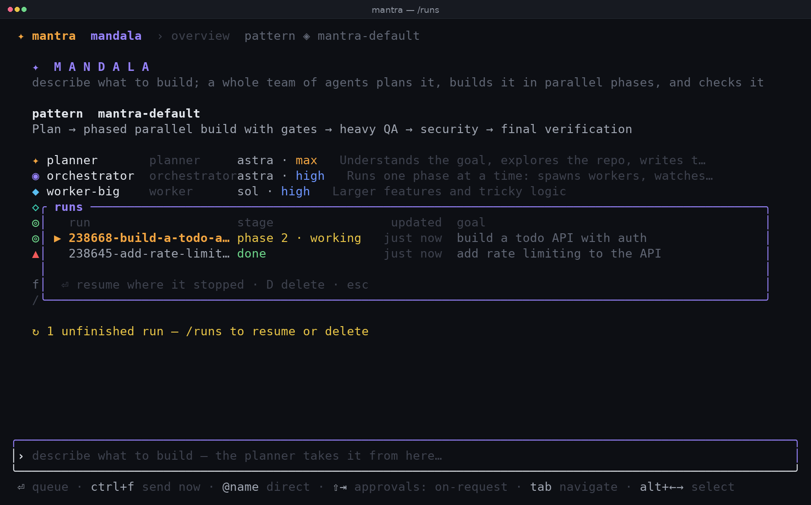

Every run writes a typed snapshot as it goes, so closing Mantra — or losing the machine — is not fatal.

```bash
mantra runs                        # title · project · stage · when · id
mantra runs resume 238330          # an id prefix is enough, from any directory
mantra runs delete 238330          # worktrees, branches and journal, after a y/N
mantra --resume-last               # this project's most recent unfinished run (cwd / --cwd)
```

`--resume-last` only ever picks a run of the project you are in (with `--demo`, the last demo run); another project's run is resumed by id, with `mantra runs resume`. **A run has one owner.** The Mantra that has a run open writes `owner.json` (pid, host, since) into the run's directory, refreshes it with every state flush and removes it when the run ends or it quits cleanly. Resuming a run whose owner is still alive on this machine is refused — from `/runs`, the CLI, `--resume-last` and the web UI alike — because two processes driving one run would each save `state.json` over the other's. A dead owner is a crash, and resumes as usual; `mantra runs resume <id> --take-over` is for the rare case the check is wrong.

A run has a **title** people can recognise — the plan's title once the planner has submitted it, the goal's first six words before that. It leads the runs list, the TUI header and the web run header; the id (`<seconds>-<slug of the goal>`) stays the stable key and is shown second. Each Codex agent's thread carries the same name, `<title> · <role>`, so a run is easy to find in Codex's own session list (Claude Code sessions have no title API, so they are left alone).

Inside the app, `/runs` lists this project's runs (`⏎` resume, `D` delete), and the welcome screen says `↻ 1 unfinished run` when there is something to pick up. `/stop` ends the active run for good — its agents shut down and the workers still queued are cancelled — and it shows in the list as *stopped*: it reopens read-only and can be landed or deleted like any run that did not finish, and a new `/run` can start at once.

<details>
<summary>What "resume" actually does</summary>

A resume never replays what the old process was in the middle of. It restarts at the nearest safe boundary:

| saved stage | on resume |
|---|---|
| planning | the planner is re-attached to its thread and asked to finish the plan |
| plan review | the saved plan goes straight back up for review |
| a phase in progress | a fresh orchestrator, briefed with the current status; the manager re-attached to its own thread; running workers re-attach to their own threads when their worktree still exists, otherwise they are re-spawned with the same prompt — each on the model it was switched to live, if you switched one (`m`, `ctrl+k`, the web picker: a switch is per agent and survives respawns and resumes; `set_role_model` is the role-wide change) |
| merging / checks / gate | the merge → checks → gate sequence simply runs again (it is idempotent) |
| finale | that step starts over, the manager re-attached |
| finished | opens read-only, so `/land` still works |

</details>

---

## Patterns and the Studio

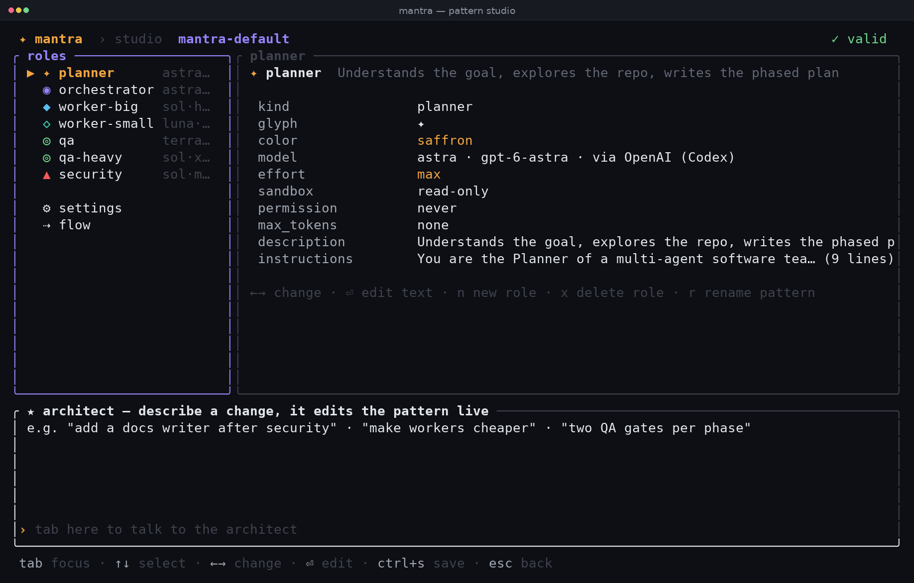

Three patterns ship in the binary (and load by name, with or without a file of your own in `~/.mantra/patterns/`). Their example roles use aliases `astra`, `sol`, `terra` and `luna`; assign those aliases to your configured models or change the roles in the Studio. The preflight names any alias that is still missing:

| pattern | for | shape |
|---|---|---|
| `mantra-default` | most work | plan → phases (fresh read-only QA gate every round, automatic fix workers) → **one** `qa-heavy` pass on the diff, with security as a checklist in its prompt → planner verification. Manager on (`manager_minutes = 10`), `review_minutes = 5`, every role on `effort = "auto"`. |
| `mantra-lean` | small and medium tasks | the same phases and gates (`gate_max_rounds = 2`) but **no manager**, no coordination review, `max_parallel = 3`, and the finale is the planner's verification alone. |
| `mantra-thorough` | releases, security-sensitive work | the heavy flow: `qa-heavy` → `security` → planner verification (heavy QA and security fix directly), manager every 5 minutes, a review every 3, named efforts up to `max`. |

Each has the same three worker classes, and the planner assigns every task to one:

| worker role | for | model | runs at once |
|---|---|---|---|
| `worker-small` `◇` | fast, focused changes in a small scope | `luna` | the shared pool, `max_parallel` (4; 3 in lean) |
| `worker-big` `◆` | larger features and tricky logic | `sol` | the same pool |
| `worker-swarm` `∴` | many tiny, independent tasks at once | `luna` | a cap of its own, `parallel = 16` |

**The swarm is a worker class, not a pattern.** The planner is told to use `worker-swarm` only when a phase is many (6+) small, independent, same-shaped tasks — per-file migrations, a test per module, repetitive edits — and then to cut one task per unit of work; everything else goes to `worker-small` or `worker-big`. Its cap is counted apart from the pool, so a wide swarm phase neither waits four at a time nor takes the slots a hard task needs, and a task queued behind a full class never blocks one that has room. The run brief tells the planner every worker role with its cap (*worker-swarm — up to 16 at once*), and a phase that uses the swarm may hold up to twice that cap in tasks — 32, where other phases hold `max_tasks_per_phase` (8) — so a swarm phase validates with default settings. `parallel` is a role field like any other: the Studio edits it (*none* shares the pool again), and a pattern file from before 0.8 has no swarm role until you add one.

**How many at once is per run.** `mantra run "<goal>" --parallel 24` is one number for every class: it sets `max_parallel` and each role's own `parallel` to 24 (1–128) in the run's own copy of the pattern — which a resume reads back — never in the saved one, with room for 24 tasks a phase when the pattern allows fewer; the planner's brief lists the caps the run will use. Workers on `bija` are small processes (32 of them are about 150 MB), so past 32 it is the provider's rate limits that bind, and the run's journal says so.

**Choosing one.** `/run` with no goal opens the new-run overlay: the patterns with their tag (*default*, *built-in*, *edited* when a file of yours shadows a built-in, *yours*) and one-line description, the current default marked, above a goal field — `↑↓` picks, `e` edits the highlighted pattern in the Studio, `⏎` starts. `/run <goal>` starts with the current pattern; `/pattern` is the same list without the goal, and picking sets the pattern for new runs (so do *Pattern* in `/settings` and `--pattern NAME`). The 0.7 built-ins `mantra-swarm`, `mantra-default-bija` and `mantra-default-claude` are gone: a saved default, `--pattern` or an old run naming one reads as `mantra-default`, and a file of your own with that name still loads as yours.

Every built-in role prompt is short and says what it owns, what it never does, when to stop — and not to re-read files it already read or run the full suite more than once a turn unless it failed.

Every built-in also sets `context_cap = 200000`: the context window each agent is told it has is the smaller of its model's window and this cap, so the backend compacts there — a 500k-token context once let one worker cycle tools for hours (6.8M tokens, mostly cached input) on a single task. `0` is the model's full window; the Studio edits it (`200k`, `off`) under settings.

Worktree isolation (`isolation = worktree`, or `auto` in a git repository) needs a commit to branch from. A repository that has none yet — `git init` and nothing else — gets an empty `mantra: initial commit` (files you already staged stay staged), and the run says so: `⎇ created the initial commit so workers get isolated worktrees`. Only a directory that is not a git repository at all makes `auto` fall back to one shared directory.

A pattern is the shape of a team: roles (kind — planner, manager, orchestrator, worker, gate — with model, effort, sandbox, permission, instructions, and for workers `parallel`), settings (parallelism, retries, gate rounds, watchdog timeouts, `review_minutes`, `manager_minutes`, `context_cap`) and flow (who plans, who manages — `flow.manager`, cyclable down to *none* — who orchestrates, who gates, what the finale chain is). It is a TOML file, and the Studio edits all of it with live validation, in the same way as `/models` and `/settings`: type over a field and `⏎` saves the pattern when it validates (otherwise it stays unsaved, the error line says why, and `ctrl+s` retries), `ctrl+n` adds a role, `Delete` (twice) removes one, and the pattern's name — the first field of the overview — saves a copy under a new name. Its flow panel shows the manager between the planner and the orchestrator.

Or describe what you want and let the **architect agent** edit the pattern while you watch: *"add a docs writer after security"*, *"make workers cheaper"*, *"put the planner on Claude"*, *"run without a manager"*.

---

## Anywhere: the web UI and remote access

Remote agent actions distinguish **Interrupt** (the current turn), **Stop agent** (the process and its delegated children), and **Stop run**. **Close Mantra** in Settings/About or the command palette ends the host instance after confirmation; saved runs and files remain, and reconnecting requires starting Mantra again on the host.


```bash
mantra --web                                          # this machine only — http://127.0.0.1:7777
mantra --web 0.0.0.0:7777 --web-tls --web-password X  # your phone, on the LAN
mantra --remote                                       # from anywhere, end-to-end encrypted
mantra --headless --web --remote                      # the same, with no terminal at all
```

The same process that draws the TUI can also serve a small, installable web app for it — chat with every agent, approve or answer from your phone, watch the pulse feed, approve a plan, start, stop and delete runs, add a provider by pasting its key, edit patterns, MCP servers and every setting — over plain HTTP on `localhost`, HTTPS on your LAN, or from anywhere through a relay that never sees a byte of it unencrypted. Nothing is bound and no cost is paid unless you ask for it.

It does what the terminal does. Beyond the Team, Run, Pulse, Inbox and Runs screens:

| where | what |
|---|---|
| **Start a run** | the goal, a **pattern** select (each with its one-line description) and an optional **workers at once** (`--parallel`) |
| **Run**, **Runs** | **Stop run** and **Delete run**, each behind a confirmation, wherever a run is shown; once a run is stopped, *Start a new run* is offered right there |
| **Settings → Solo, Runs, Features** | the same fields as `/settings`: model, approvals, sandbox, MCP servers for Solo, default pattern, notifications, Akasha |
| **Settings → MCP servers** | add a server (a name and a command line), enable or disable it, test it, remove it |
| **Settings → Models & providers** | the aliases as a table (provider, model, context, effort, vision) edited cell by cell, with delete, add and *Test*; the providers likewise; **Add provider** — paste the key, confirm the URL, *Probe*, tick the models, add — and *Add Codex* / *Add Claude Code* |
| **Settings → Patterns** | the patterns with their tags; an editor with a card per role (model, effort, sandbox, permission, parallel, fallback, MCP, instructions), the settings, the flow and the groups; *Save* (the errors shown), *Save as copy*, *Delete* (yours only), *Use for new runs* |
| **Settings → Web & remote, Appearance, Notifications, About** | the remote link, QR code and certificate; the look; Web Push; versions and paths |
| the command palette | Stop run, New run, every settings section, Models, Patterns |

On a phone the settings are a list of sections that open as pages, all of it from the *More* tab; on a desktop they sit in the main column. Every one of these goes through the same code as its terminal twin, so the two accept the same things — and no reply ever carries a key: the web password reads *set*, and a provider's key is masked to its last four characters.

<details>
<summary><code>--web</code>: on this machine or your LAN</summary>

`--web` (optionally `--web ADDR:PORT`, or the explicit `--web-listen ADDR:PORT`) starts an HTTP+WebSocket server in the same process, defaulting to `127.0.0.1:7777` — loopback, no password needed, since anyone who can reach it can already run `mantra` itself (mind that a port-forward or tunnel to that port — `ssh -L`, `docker -p` — lets its other end in too; Mantra says so once at start). Bind anything else (`--web 0.0.0.0:7777` for the LAN) and Mantra refuses to start without a password: `--web-password PW`, the environment variable `MANTRA_WEB_PASSWORD` (preferred — flags show up in `ps`), or `[web] password` in `settings.toml`. *Web & remote* in the TUI's `/settings` shows the exact URL(s), whether TLS and a password are on, and how many browsers are connected right now.

`--web-tls` serves HTTPS with a small private certificate authority Mantra makes for itself the first time (`$MANTRA_HOME/web/tls/`), covering `localhost`, your LAN address and hostname, reissued only when those change or it is close to expiring. `/cert.pem` on the running server hands out that CA (the web app's Settings › Certificate card has the download button and these same steps) — install it *once* per device and every certificate this Mantra ever issues for itself afterwards (even after your IP changes) is already trusted:

| device | steps |
|---|---|
| iPhone / iPad | open `/cert.pem` in Safari → *Profile Downloaded* → Settings › Profile Downloaded › Install → Settings › General › About › Certificate Trust Settings → full trust for "mantra on …" |
| Android | download `/cert.pem` → Settings › Security › Encryption & credentials › Install a certificate › CA certificate (Chrome trusts it after a restart; some other browsers ignore user CAs for service workers — use Chrome) |
| macOS | open `/cert.pem` in Keychain Access (System keychain) → double-click it → Trust → *Always Trust* |
| Windows | open `/cert.pem` → Install Certificate → Local Machine → Trusted Root Certification Authorities |
| Linux (Chrome) | `chrome://settings/certificates` › Authorities › Import |
| Firefox | `about:preferences#privacy` › Certificates › Authorities › Import |

`--web-cert FILE --web-key FILE` uses a certificate you already have instead. Without TLS the web UI still works on `localhost`, but a phone can't install it as an app or get notifications over plain HTTP.

**Installing it as an app.** Over HTTPS, Android/Chrome offers an *Install* button; on iPhone/iPad use Safari's **Share › Add to Home Screen** — iOS only delivers notifications to an installed app, and the UI says so once, in place. Either way you get a full-screen icon, offline shell caching, and a layout that respects the notch and the home indicator.

**Patterns.** Settings → Patterns lists the patterns and edits their roles — model, effort, the worker caps — and what you save is written straight back into the pattern file, the same file the Studio and `ctrl+k` edit.

**Notifications.** Once installed, Settings → Notifications turns on Web Push — implemented by hand, no third-party push service in the middle — for halts, questions, approvals, plan review, a finished run and a finished Solo turn, each toggle separate, with a *Send a test* button. Subscriptions and push keys live in `$MANTRA_HOME/web/push/`, `0600`; turn it off server-wide with `[web] push = false`.

</details>

<details>
<summary><code>--remote</code>: the same session from anywhere, end-to-end encrypted</summary>

`--remote` (optionally `--remote wss://your-relay`) dials *out* to a relay — `wss://remote.mantra.codes` by default — so the web UI reaches you from anywhere without opening a port on your machine or trusting the relay with anything: it only ever forwards ciphertext. *Web & remote* in the TUI's `/settings` shows the link, a QR code (`⏎` on the link row shows it full size), a short code, and the password, and rotates the identity (the old link, code and QR stop working immediately).

- **Link** — `https://remote.mantra.codes/s/<sid>#k=<key>`. The key lives only in the URL fragment, which browsers never send to a server; opening it derives the key and connects straight through.
- **Code + password** — the same session as a short code (grouped in dashes) typed in at remote.mantra.codes, plus the password. For reading aloud, or typing into a device you didn't get the link on.
- **Password** — set your own, or let Mantra generate a four-word one the first time `--remote` runs (`amber-kite-river-nine`, from a fixed 256-word list) and show it in *Web & remote* in `/settings`. It also derives the link's key, so changing it — or rotating — invalidates old links and codes.
- **What the relay can and cannot see.** Your host and the connecting browser derive a shared key from the password (PBKDF2, then a fresh HKDF key per connection) that never reaches the relay, and every message after that is AES-256-GCM end-to-end encrypted. The relay sees your IP, the browser's IP, and encrypted bytes — never the password, the key, or anything your agents say. A wrong password or code fails to decrypt the very first frame ("Wrong password or code") rather than quietly connecting into someone else's session.
- **A relay on its own host.** The relay only forwards bytes; it does not have to be the same machine — or run by the same person — as whatever serves the web app the link opens. `--remote-site URL` (or `[web] remote_site` in settings) points the link at that site explicitly; left unset, it defaults to the relay's own origin. Point `--remote` at a relay you run yourself and Mantra never depends on `remote.mantra.codes` at all. The web app a relay serves is the bundle built from this repository's tag: rebuild a self-hosted relay's `remote-ui` image at `v0.9.0` (`MANTRA_REF`) to get the screens above — an older bundle keeps working with the commands it knows, it just lacks them.
- **One hosted session per IPv4 address.** `remote.mantra.codes` allows one `mantra --remote` session per IPv4 address at a time — a second one dialing in from behind the same address (the same office, the same home network) is refused until the first disconnects, and Mantra reports that plainly instead of silently taking over.
- **Behind a proxy.** The relay is dialed through the usual variables: `https_proxy` / `HTTPS_PROXY` for a `wss://` relay, `http_proxy` / `HTTP_PROXY` for `ws://`, `all_proxy` for either (lowercase is read first), `user:pass@` credentials included. `no_proxy` / `NO_PROXY` exempts hosts (`*`, a host or domain suffix, an IPv4 CIDR); a relay on `localhost` or a loopback address is never proxied, whatever the variables say. Only `http://` proxies work — the relay is reached with HTTP `CONNECT`, TLS still runs end to end through the tunnel and the certificate is checked as usual; a `socks5://` or `https://` proxy URL is refused with a hint (an `http://` proxy, or `no_proxy` for the relay host). Behind a TLS-inspecting proxy, or with a self-hosted relay on a private CA, `SSL_CERT_FILE` adds a PEM bundle to the built-in roots, and an untrusted relay certificate points at it. Proxy failures are reported as the proxy's (*refused the CONNECT (HTTP 403)*, *cannot reach the proxy*), not as a dead relay.

</details>

<details>
<summary><code>--headless</code>: no terminal at all</summary>

`--headless` runs the same engine with no terminal whatsoever — no raw mode, no input thread, nothing drawn — for a machine you only ever reach through the web UI or `--remote`. It needs at least one of `--web`/`--remote` (otherwise nothing would be reachable), a password whenever `--web` is on (a headless machine has nobody at the keyboard to notice a stranger on the loopback port; `--remote` alone generates one), and `ctrl+c` or `SIGTERM` shuts it down cleanly. The web URL prints once to stderr at start, since there's no screen to show it on; the relay's status follows — *waiting for the relay*, connected, reconnected, each error once with its retry delay (again only when the text changes or after a minute) — and the link, code and password print once the relay has actually answered, never before.

</details>

**`[web]` in `settings.toml`** — everything here is also a flag, and a flag always wins (`listen`, `password`, `tls` and `push` are also fields of *Web & remote* in `/settings`, read at the next start):

| key | default | meaning |
|---|---|---|
| `listen` | `127.0.0.1:7777` | where `--web` binds |
| `password` | *(none)* | web UI password; prefer `MANTRA_WEB_PASSWORD` |
| `tls` | `false` | Mantra's own certificate when true |
| `cert` / `key` | *(none)* | your own PEM certificate + key (implies TLS) |
| `relay` | `wss://remote.mantra.codes` | the relay `--remote` dials |
| `remote_site` | *(the relay's own origin)* | the site remote links open, when it's not the relay's host |
| `sans` | `[]` | extra DNS names/IPs for the self-signed certificate |
| `push` | `true` | Web Push notifications |
| `contact` | `https://mantra.codes` | the VAPID contact used for push |

`$MANTRA_HOME/web/` holds everything this needs — TLS certificate, push keys and subscriptions, sessions, the remote identity — each file `0600`.

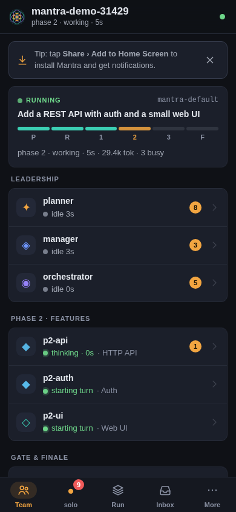 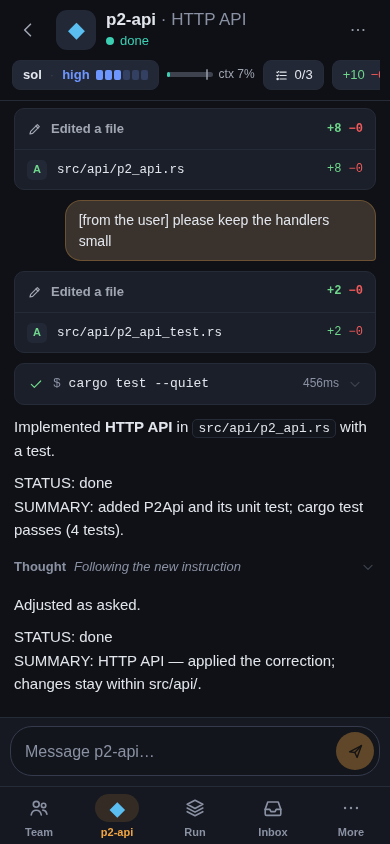

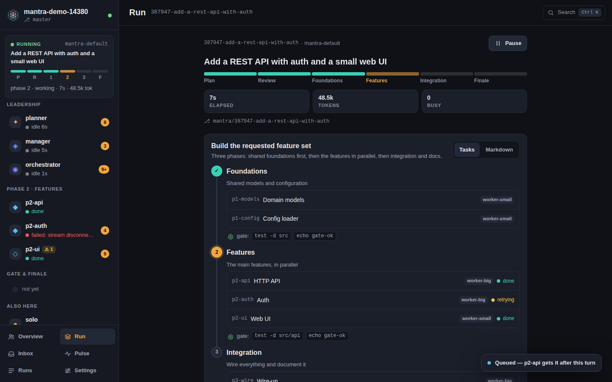

---

## Keys

Four groups: what works everywhere, in a chat, on the Mandala stage, and on the config screens (`/models`, `/studio`, `/settings`). `?` or `F1` — and `/help` — open the same list in the app, and each screen's footer shows only what works there.

<details>
<summary>Everywhere</summary>

| key | does |
|---|---|
| `ctrl+o` | switch Solo ⇄ Mandala |
| `ctrl+k` | model picker (`←→` effort, `+/-` context) |
| `ctrl+g` | inbox: approvals and alerts from every agent |
| `ctrl+e` | verbose log |
| `ctrl+c` | close an overlay / **stop** a busy Solo turn while keeping your draft / clear an idle input · three presses quit |
| `ctrl+l` | redraw |
| `/` | the commands — `tab` completes them and their arguments (`@names`, groups, agents) |

</details>

<details>
<summary>Chat: Solo, a zoomed agent, the stage's prompt</summary>

| key | does |
|---|---|
| `⏎` | send — while the agent works it queues behind the running turn |
| `ctrl+f` | force-send a queued message into the running turn |
| `ctrl+x` | discard the queue |
| `alt+↑/↓` | raise / lower reasoning effort |
| `shift+tab` | cycle approvals: untrusted → on-request → never ask |
| `ctrl+d` | diff viewer |
| `ctrl+t` | side panel (the pulse feed on the stage) |
| `ctrl+r` | respawn the focused agent |
| `esc` | clear the input; in a zoom, back to the overview |

`ctrl+t` and `ctrl+d` mean this only on the chat screens; the config screens reuse the two chords.

</details>

<details>
<summary>The Mandala stage</summary>

| key | does |
|---|---|
| `tab` | switch between typing and navigating |
| `←→↑↓` | select a card · `1`–`9` jump to the *n*th and zoom (one card per task: a retried task counts once, and the selection is the attempt the card shows) |
| `⏎` | zoom in · `esc` back to the overview (esc never interrupts) |
| `space` | pause / resume the run |
| `r` | respawn the selected agent (a respawned worker's card stays selected once its new attempt starts) · `m` switch its model |
| `x` | interrupt · `c` compact · `+/-` effort |
| `p` | plan · `a` approve |
| `@name …` | message one agent (`@manager` included); plain text re-prompts the planner — or answers the planner's or the manager's open question |

What used to be `d`, `i` and `s` here are `ctrl+d`, `ctrl+g` and `/studio`.

</details>

<details>
<summary>Config screens: /models, /studio, /settings</summary>

One editing model for all three — there is no popup to edit in:

| key | does |
|---|---|
| *type* | on a text field, any printable key starts editing it in place with that key as the new content (the old value is gone until `esc` brings it back); `Backspace` starts editing with the value cleared |
| `⏎` | edit the field's value (the cursor at its end); while editing, commit it and **save the file** |
| `↑` `↓` | while editing, commit and move to the next row |
| `esc` | revert the edit in progress; otherwise back to where you came from |
| `←→` `space` | cycle a choice, flip an on/off; a typed letter jumps to the first option that starts with it. On the models grid `←→` move between cells, and `+/-` and `space` change the value |
| `ctrl+n` | add: on `/models` a provider from an API key, a model on an existing provider, Codex, or Claude Code; in the Studio a role; in Settings an MCP server |
| `Delete` | remove the selected row — press it twice within 3 s |
| `ctrl+t` | test the selected model or MCP server |
| `ctrl+d` | discover the selected provider's models |
| `ctrl+s` | save now — nothing needs it, but it retries a pattern that did not validate |
| `tab` | on `/models`, between the models grid and the providers grid |

`/models` saves `models.toml` on every commit. The Studio validates the whole pattern on commit: valid, it is saved; invalid, it stays unsaved and the error line says why.

</details>

<details>
<summary>Slash commands</summary>

Nineteen, and none needs its parameter typed: leave it out and a selector opens, or `tab` completes it.

| command | does |
|---|---|
| `/run` | start a run: the pattern list above a goal field; `/run <goal>` starts at once with the current pattern |
| `/runs` | this project's runs: resume, land or delete |
| `/stop` | stop the active run for good (`/runs` keeps it) |
| `/pause` | pause / resume the run |
| `/plan` | show the run's plan |
| `/land` | merge the finished run into your branch |
| `/respawn` | respawn a run agent in place: `/respawn [agent]` — a selector when none is focused |
| `/akasha` | the run's shared notes: `/akasha [group]` — a selector when there are several groups |
| `/inbox` | approvals and alerts |
| `/pattern` | choose the pattern for new runs |
| `/studio` | the pattern studio: roles, flow, the architect |
| `/models` | models and providers: add from a key, test, discover |
| `/settings` | Solo, runs, features, MCP servers, web and remote, appearance |
| `/model` | switch the model (the picker; `←→` effort) |
| `/new` | a fresh Solo session |
| `/compact` | compact the focused agent's context |
| `/diff` | the changes viewer |
| `/help` | keys and commands |
| `/quit` | exit Mantra |

`!cmd` runs a shell command in Solo. The commands that were settings — effort, approvals, MCP servers, experimental features, the web UI and remote access, the verbose log, the Mandala stage — are in `/settings` and on keys now; typing one of the old names says where it went.

</details>
---

## Under the hood

<details>
<summary>Architecture in one paragraph</summary>

One process per agent, supervised by a hub: `bija` (the default) and `claude -p` speak NDJSON and `codex app-server` JSON-RPC, all over stdio, and all three are translated into the same internal events, so the engine and UI have no backend-specific branches. `bija` is the one Mantra ships itself: a single-threaded harness that calls the provider's API directly, runs the file tools itself and commands as its own children, and keeps every session on disk so a crash resumes mid-turn; quitting Mantra gives the bija agents up to 3 s, together, to end their commands and close their transcripts. The Mandala flow is a deterministic Rust state machine — spawning, retrying, merging, running checks, advancing phases — and agents are woken only for judgment calls, which they make through tools Mantra executes. Crashes are isolated: one agent restarts (with its thread resumed) while the rest keep working. Agents Mantra spawns never pick up the MCP servers of your own Codex or Claude Code setup — only Mantra's own tools and the servers you give Solo or a role in Mantra's settings reach them, so a personal MCP setup never changes what a team run can do.

[`DESIGN.md`](DESIGN.md) is the long version: the seam between backends, the MCP bridge, halts, the watchdog, resumable runs, the security model and the testing strategy.

</details>

<details>
<summary>Files it writes</summary>

| path | what |
|---|---|
| `~/.mantra/settings.toml` | CLI commands, defaults, approvals, UI options (`$MANTRA_HOME` moves the lot) |
| `~/.mantra/models.toml` | models, context windows, efforts, providers (`0600` when it stores a key) |
| `~/.mantra/patterns/*.toml` | your patterns |
| `~/.mantra/runs/<project>/<id>/` | state, plan, journal, per-phase outputs, merge logs, the agents' `screenshots/` |
| `~/.mantra/screenshots/` | Solo's screenshots |
| `~/.mantra/worktrees/<id>/` | per-run worktrees, cleaned up as phases complete |
| `~/.mantra/bija/sessions/<id>/` | one Bija agent's session: `session.json`, `transcript.jsonl`, the `system.md`, `tools.json` and `mcp.json` Mantra hands it, the `images/` its tools returned, background-job logs |
| `~/.mantra/logs/mantra.log` | debug log |
| `~/.mantra/web/` | TLS certificate, Web Push keys/subscriptions, web sessions, remote identity (`--web`/`--remote`; `0600`) |

Nothing is written into your project. A repo may *ship* patterns in `<repo>/.mantra/patterns/`, which Mantra reads but never creates.

</details>

<details>
<summary>Terminal support, tmux, accessibility</summary>

Linux and macOS terminals: kitty, WezTerm, Ghostty, Alacritty, iTerm2, Terminal.app, GNOME Terminal, Konsole, foot, tmux/screen, the Linux console. Colour depth is detected (truecolor → 256 → 16) and glyphs fall back to ASCII where Unicode is not available — in ASCII mode every cell is guaranteed pure ASCII. Minimum size 40×12.

In `settings.toml` (or *Appearance* in `/settings`): `colors`, `glyphs`, `reduce_motion`, `mouse`, `fps`, `notify`. Idle screens render at 0 fps, and a panic inside drawing is caught and logged instead of taking your agents down.

Recommended tmux lines — `mantra doctor` checks them:

```tmux
set -sg escape-time 10                  # otherwise Esc lags by half a second
set -g default-terminal "tmux-256color"
set -as terminal-features ",*:RGB"      # truecolor
set -g allow-passthrough on             # desktop notifications from inside tmux
```

</details>

<details>
<summary>How this is tested, and what is not covered</summary>

- `cargo build`; more than 650 unit tests in `mantra` (including the chain of command, escalation to the manager and then the planner with its deadlines and watchdog rungs, revision-resume and the periodic review against a fake `Ctx`, the Claude gauge against per-call usage, and 50 for the web UI and remote relay: PBKDF2/HKDF/AES-GCM known-answer and round-trip vectors, every protocol message round-tripping, snapshot/delta diffing, TLS certificate reissue rules, login rate-limiting, and the relay — IPv4-only dialling, the one-session-per-IPv4 refusal shown and retried, a fake relay carrying a real browser handshake end to end), and `scripts/stress.sh`: every screen and overlay rendered at 13 terminal sizes through a whole simulated run, plus a mixed Codex/Claude run over the real MCP bridge, a worker that asks a question mid-phase, a hand stop that must stay stopped, the halt band, the watchdog, zoom-vs-overview, leave → list → resume → delete, and the sandbox notice — in a debug build where arithmetic overflow panics.
- `bija`'s own unit tests (the sandbox's path policy, the transcript's repair, both wires against sample streams, the retry policy) and end-to-end tests that drive the real binary against an in-test mock API.
- `docs/tools/bija-e2e.sh`: a whole Mandala on the real `bija` binary against the demo's mock API (`src/mock_openai.rs`, which streams the provider's own SSE shape) — the run must reach Done with every agent a Bija session on disk and the workers' files on the run branch; `MANTRA_MOCK_FLAKY=<n>` answers every n-th request with a 503 to put bija's retries in the loop.
- `docs/tools/swarm-e2e.sh`: `mantra run --parallel 8` in `--demo` on the default pattern, with a goal that asks for a swarm — the run must reach Done, its own copy of the pattern must carry the 8, the plan must hold a phase of at least eight `worker-swarm` tasks, more than four of them must have run at once within the cap, and a worker must have shared an Akasha note.
- `docs/tools/mcp-e2e.sh`: the same run with the demo's MCP server and a stand-in screen capture (`MANTRA_SCREENSHOT_CMD`), on bija and on the Claude Code mock — a worker's `scene_info` call must reach the server and come back, a screenshot must land in the run's `screenshots/` and in a bija session's `images/`.
- Real runs against live providers with **Codex 0.154.0** and **Claude Code 2.1.269**: Solo turns, full team runs through gates and finale (LibertAI, and OpenRouter's `openai/gpt-5.6-luna` through Codex's Responses API), compaction on a 16k window, a run left mid-phase and resumed with its worker re-attached, and the bad-key path halting in seconds.
- Bija against a live OpenAI-compatible gateway (LibertAI through a proxy): a Solo turn, a standalone `bija run` with a file write and a command, a SIGKILL mid-command resumed with `--resume`, a full Mandala to Done (0.7's `mantra-default-bija`, which is `mantra-default` now), and a four-wide swarm run with Akasha on (0.7's `--swarm 4`; `--parallel 4` and the `worker-swarm` class now) — three workers in parallel, fix workers resolving merge conflicts, 18 shared notes — all producing code whose tests passed. 40 idle `bija` processes measured at 4.7 MB each and no CPU.
- **Not covered:** Claude Code with a *subscription* login (this build machine has none — API-key mode is verified), macOS runtime integration tests, and Windows, which is not supported.

</details>

<details>
<summary>Reporting a problem</summary>

One command collects everything useful into a single text file — versions, `mantra doctor`, login state (subscription or key, never the credentials), terminal and sandbox facts, your settings and models, the newest runs (plan, journal, phase outputs, merge logs) and the tail of `mantra.log`:

```bash
curl -fsSL https://raw.githubusercontent.com/sahelea1/mantra/master/support-bundle.sh | sh > mantra-bundle.txt
```

Anything that looks like an API key is redacted before it is written, and nothing leaves your machine — skim the file, then attach it to an issue together with what you did and what you expected. `BUNDLE_RUNS=5` includes more runs, `BUNDLE_LOG=5000` more log lines, and `MANTRA_BIN=/path/to/mantra` points it at a binary that is not on your `PATH`.

</details>

<details>
<summary>Regenerating the screenshots and the logo</summary>

```bash
cd mantra_src && cargo build
pip install Pillow fonttools            # plus tmux
python3 docs/tools/shoot.py             # every screenshot, from demo mode
python3 docs/tools/logo.py              # the mark and the banner
```

`docs/tools/termshot.py` drives the binary in tmux at a fixed size, captures the frame with its colours and paints it into a PNG — so the images in this README are real frames, not mock-ups.

</details>

---

<div align="center">


**Mantra v0.9.0** · MIT · [changelog](CHANGELOG.md) · [design notes](DESIGN.md)

</div>
